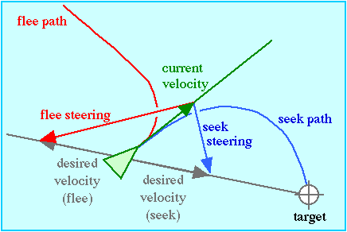

<!--
HOW TO REUSE
  Section divider : `# Title {.section-divider}` then one line of text.
  Columns         : ::: {.columns} ::: {.column} ... ::: ::: {.column} ... ::: :::
  Other classes   : .callout  .diagram-placeholder  .code-example  .equation
                    .small-text  .muted  .center-content
  Theme colours   : edit :root variables and SCSS variables in styles.css.
-->

# Introduction {.section-divider}

[One-line overview of this section.]

## What Are Steering Behaviours?

Steering behaviors are a suite of algorithms used to make playable characters and AIs move smoothly in various ways: following a target, slowing down when arriving at a location, following a path, following each other in a queue, etc.
<!--

- [Key point 1]
- [Key point 2]
- [Key point 3]

::: {.callout}
**Note:** [Optional remark or definition.]
:::

-->

## How does it work?

<video autoplay loop muted playsinline
       style="width: 70%; max-height: 500px; object-fit: contain;">
  <source src="videos/steering_behaviors.mp4" type="video/mp4">
</video>

## The Steering Model

The behavior of an autonomous character is divided into 3 layers. Turned into a hiearchy of three layers:

- Action selection (strategy, goals, planning)
- Steering (path determination)
- Locomotion (animation, articulation)

::: {.diagram-placeholder}
[Diagram: action selection → steering → locomotion]
:::

# Mathematical Foundations {.section-divider}

[One-line overview of this section.]

## Vectors and Kinematics

[Explain position, velocity, and acceleration vectors here.]

::: {.equation}
$$\mathbf{p}_{t+1} = \mathbf{p}_t + \mathbf{v}_t\,\Delta t$$
:::

::: {.small-text .muted}
[Notes on notation.]
:::

## Steering Force and Truncation

[Explain steering = desired velocity − current velocity.]

::: {.equation}
$$\mathbf{F}_{steer} = \mathbf{v}_{desired} - \mathbf{v}$$
:::

::: {.callout}
[Explain truncation by maximum force and speed.]
:::

# Individual Behaviours {.section-divider}

[One-line overview of this section.]

## Seek and Flee

::: {.columns}
::: {.column}
### Seek

Moves the character towards a specific position in the global space, while adjusting its velocity aligned towards the target.

:::
::: {.column}
### Flee

Is the inverse of Seek and makes the character's desired velocity point in the opposite direction of the target.

:::
:::

## Arrive

It's identical to seek when far from its target. But when the character approaches its target, it begins to slow down to stop more smoothly.


## Pursuit and Evasion

::: {.columns}
::: {.column}
### Pursuit

Is similar to seek, but it predicts the future position of the target based on its current velocity and adjusts the character's desired velocity accordingly.

:::
::: {.column}
### Evasion
Is the inverse of pursuit and makes the character's desired velocity point in the opposite direction of the predicted future position of the target.


:::
:::

## Wander and Obstacle Avoidance

::: {.columns}
::: {.column}
### Wander

Type of random steering, the character moves randomly within a certain area.

:::
::: {.column}
### Obstacle Avoidance

[Explain the obstacle avoidance behaviour here.]
:::
:::

## Code Example: Seek

::: {.code-example}
```javascript
function seek(agent, target) {
  // [Replace with your implementation]
  const desired = normalize(sub(target, agent.pos));
  return sub(scale(desired, agent.maxSpeed), agent.vel);
}
```
:::

[Explain the code here.]

# Group Behaviours {.section-divider}

[One-line overview of this section.]

## Separation, Alignment, Cohesion

::: {.columns}
::: {.column}
### Separation
[Explain here.]
:::
::: {.column}
### Alignment
[Explain here.]
:::
::: {.column}
### Cohesion
[Explain here.]
:::
:::

## Flocking: Code and Visualization

::: {.columns .center-v}
::: {.column}
::: {.code-example}
```javascript
function flock(agent, neighbours) {
  // [Replace with your implementation]
  return add(separation(agent, neighbours),
             alignment(agent, neighbours),
             cohesion(agent, neighbours));
}
```
:::
:::
::: {.column}
::: {.diagram-placeholder}
<svg viewBox="0 0 200 120" width="100%" aria-label="Placeholder agents">
  <g fill="#38bdf8">
    <polygon points="40,60 24,52 24,68"/>
    <polygon points="80,40 64,32 64,48"/>
    <polygon points="90,85 74,77 74,93"/>
    <polygon points="130,60 114,52 114,68"/>
  </g>
  <circle cx="90" cy="62" r="50" fill="none" stroke="#22314d" stroke-dasharray="4 4"/>
</svg>
:::
:::
:::

# Combining Behaviours {.section-divider}

[One-line overview of this section.]

## Weighted Blending

[Explain weighted sums of steering forces here.]

::: {.equation}
$$\mathbf{F} = \sum_i w_i\,\mathbf{F}_i$$
:::

## Prioritization and Arbitration

::: {.columns}
::: {.column}
### Priority-based
[Explain here.]
:::
::: {.column}
### Weighted truncated sum
[Explain here.]
:::
:::

# Demonstration {.section-divider}

[One-line overview of this section.]

## Interactive Simulation

::: {.center-content}
<canvas class="sim-frame" data-demo="seek" width="1100" height="480"></canvas>
:::

::: {.small-text .muted}
[Replace the canvas drawing in `scripts.js` with your simulation.]
:::

# Conclusion {.section-divider}

[One-line overview of this section.]

## Summary

- [Takeaway 1]
- [Takeaway 2]
- [Takeaway 3]

::: {.callout}
[Closing remark or open question.]
:::

## References

::: {.small-text}
1. [Reference 1]
2. [Reference 2]
3. [Reference 3]
:::

## Questions? {.center-content}
<br>
<br>
<br>
Thank you for your attention!
