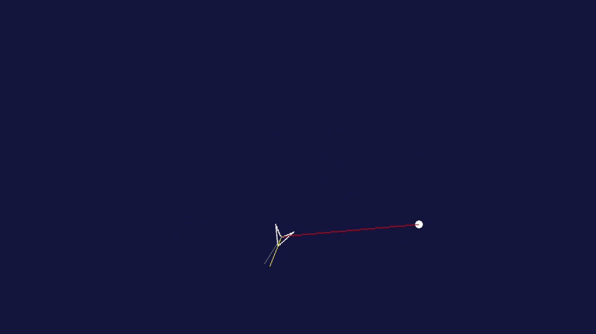
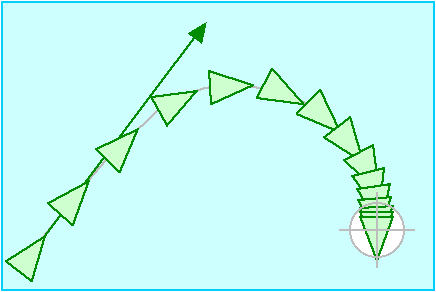
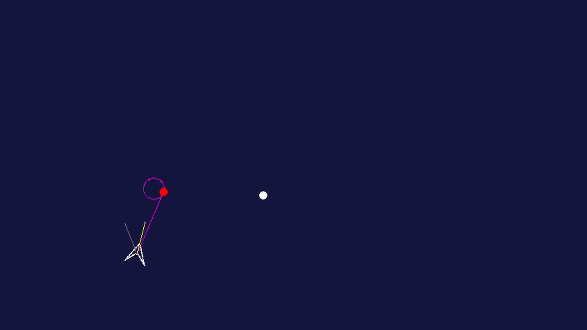
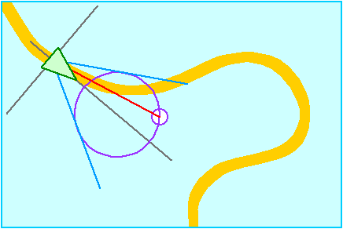
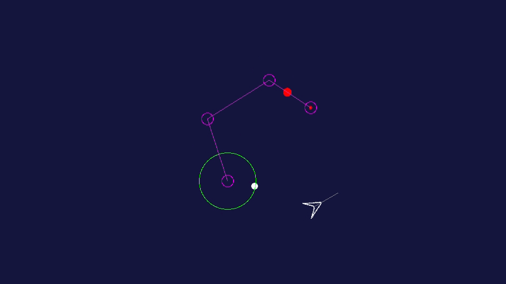
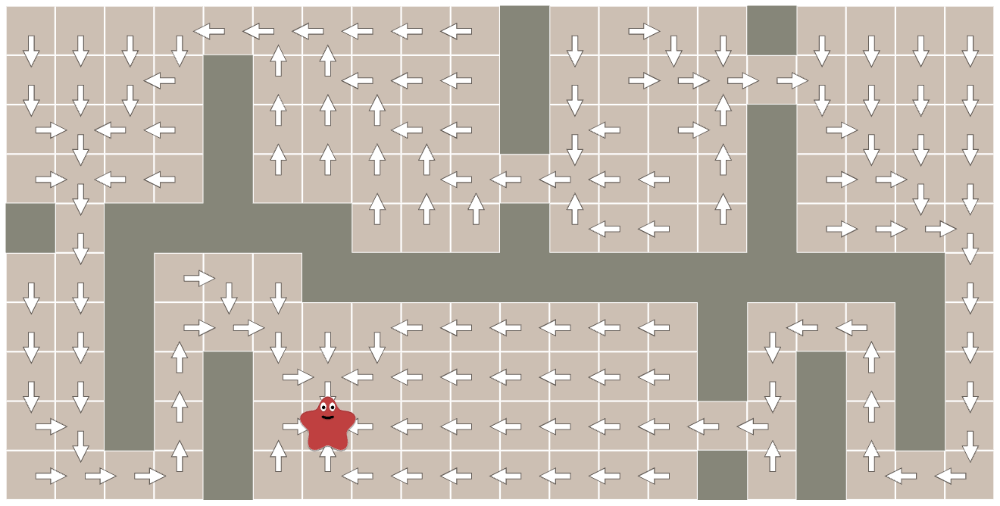

<!--
HOW TO REUSE
  Section divider : `# Title {.section-divider}` then one line of text.
  Columns         : ::: {.columns} ::: {.column} ... ::: ::: {.column} ... ::: :::
  Other classes   : .callout  .diagram-placeholder  .code-example  .equation
                    .small-text  .muted  .center-content
  Theme colours   : edit :root variables and SCSS variables in styles.css.
-->

# Introduction {.section-divider}

Algorithms that help autonomous characters move in a more realistic and intelligent way.

## What Are Steering Behaviours?

Steering behaviors are algorithms that help autonomous characters move in a more realistic and intelligent way.

- Decide when to move smoothly, accelerate, decelerate, or navigate around the environment.
- Avoid heavy pathfinding or physics engines by using simple local mathematics and vector calculations.
- Highly CPU efficient, allowing integration into mobile games without performance issues.

## How does it work?

<video autoplay loop muted playsinline
       style="width: 70%; max-height: 500px; object-fit: contain;">
  <source src="videos/steering_behaviors.mp4" type="video/mp4">
</video>

## The Steering Model

[Describe the layered model: action selection, steering, locomotion.]

::: {.diagram-placeholder}
[Diagram: action selection → steering → locomotion]
:::

# Mathematical Foundations {.section-divider}

Simple local mathematics and vector calculations for realistic movement.

## Vectors and Kinematics

[Explain position, velocity, and acceleration vectors here.]

::: {.equation}
$$\mathbf{p}_{t+1} = \mathbf{p}_t + \mathbf{v}_t\,\Delta t$$
:::

::: {.small-text .muted}
[Notes on notation.]
:::

## Steering Force and Truncation

[Explain steering = desired velocity − current velocity.]

::: {.equation}
$$\mathbf{F}_{steer} = \mathbf{v}_{desired} - \mathbf{v}$$
:::

::: {.callout}
[Explain truncation by maximum force and speed.]
:::

# Individual Behaviours {.section-divider}

Core local steering behaviours for single-agent navigation.

## Seek and Flee

::: {.columns}
::: {.column}
### Seek

Moves the character towards a specific position in the global space, while adjusting its velocity aligned towards the target.


:::
::: {.column}
### Flee

The inverse of Seek and makes the character’s desired velocity point in the opposite direction of the target.


:::
:::

## Arrive

Identical to seek when far from its target. But when the character approaches its target it begins to slow down to stop more smoothly.

::: {.columns}
::: {.column}



:::
::: {.column}



:::
:::

## Pursuit and Evade

::: {.columns}
::: {.column}
### Pursuit

Similar to Seek but the character chases another moving character, attempts to predict where they are headed and tries to cut them off instead of just following the target.

:::
::: {.column}
### Evasion

The opposite of pursuit, the character tries to escape from other character, while trying to predict the target’s movement and adapt.

:::
:::

::: {.columns}
::: {.column}


:::
::: {.column}


:::
:::

## Wander

A type of random steering, the character moves randomly within a certain area.

::: {.columns}
::: {.column}



:::
::: {.column}



:::
:::

## Obstacle Avoidance

The character manoeuvres through the environment by dodging around obstacles, takes action only when a nearby obstacle is in front of the character.

::: {.columns}
::: {.column}


:::
::: {.column}


:::
:::

## Follow Path

A character steers along a predetermined path, moves through a series of points along the path. The goal is to 
move the character along the path while staying within the specified radius.


::: {.columns}
::: {.column}



:::
::: {.column}


:::
:::


## Flow Field Following

Directs the motion of characters based on their position within an environment.


::: {.columns}
::: {.column}


:::
::: {.column}



:::
:::

## Code Example: Seek

::: {.code-example}
```javascript
function seek(agent, target) {
  // [Replace with your implementation]
  const desired = normalize(sub(target, agent.pos));
  return sub(scale(desired, agent.maxSpeed), agent.vel);
}
```
:::

[Explain the code here.]

## Additional Individual Behaviours

::: {.columns}
::: {.column}

### Flow Field Following

Directs the motion of characters based on their position within an environment.
:::
:::

### Unaligned Collision Avoidance

Tries to keep the characters which are moving in arbitrary directions from running into each other, by avoiding collisions and avoid being stuck.

# Group Behaviours {.section-divider}

Coordinated movement across multiple nearby characters.

## Separation, Alignment, Cohesion

::: {.columns}
::: {.column}
### Separation

The character maintains a separation distance from other characters nearby to prevent crowding.
:::
::: {.column}
### Alignment

The character gains the ability to align its direction and speed with other characters nearby to have the same pace.
:::
::: {.column}
### Cohesion

The character gains the ability to approach and form a group with other characters nearby.
:::
:::

## Flocking: Code and Visualization

Flocking simulates the movement of characters that are grouped together, combining Separation, Cohesion, and Alignment behaviors to replicate birds or fish flocks, for example.

::: {.columns .center-v}
::: {.column}
::: {.code-example}
```javascript
function flock(agent, neighbours) {
  // [Replace with your implementation]
  return add(separation(agent, neighbours),
             alignment(agent, neighbours),
             cohesion(agent, neighbours));
}
```
:::
:::
::: {.column}
::: {.diagram-placeholder}
[Diagram: flocking visualization]
:::
:::
:::

## Leader Following

Makes one or more characters follow another moving character as their leader, staying near them without getting in their way.

# Combining Behaviours {.section-divider}

A character may switch between behavior modes as circumstances change in the game, such as events.

## Weighted Blending

Some behaviors are commonly blended together and effectively act in parallel. A good example is when an animal NPC is running through the woods escaping a predator: this NPC can use the flee and obstacle avoidance behaviors to navigate effectively.

::: {.equation}
$$\mathbf{F} = \sum_i w_i\,\mathbf{F}_i$$
:::

# Demonstration {.section-divider}

Interactive steering behaviours in action.

## Interactive Simulation

::: {.center-content}
<canvas id="steering-canvas" width="900" height="450"></canvas>
:::

::: {.small-text .muted}
[Replace the canvas drawing in scripts.js with your simulation.]
:::

# Conclusion {.section-divider}

Why use steering behaviours and where they appear in games.

## Summary

- **Performance:** Highly CPU efficient by using simple local mathematics and vector calculations—ideal even for mobile games.
- **Realism:** Movement can be very realistic due to velocity and path changes, with many different NPC actions when behaviors are combined.
- **Use Cases:** Used across many genres with large numbers of NPCs—Racing (AI opponents/traffic), Driving (AI traffic), Action, Role-Playing, and Open-World games.

::: {.callout}
[Closing remark or open question.]
:::

## References

::: {.small-text}
- [Reference 1]
- [Reference 2]
- [Reference 3]
:::

## Questions? {.center-content}