<!--
HOW TO REUSE
  Section divider : `# Title {.section-divider}` then one line of text.
  Columns         : ::: {.columns} ::: {.column} ... ::: ::: {.column} ... ::: :::
  Other classes   : .callout  .diagram-placeholder  .code-example  .equation
                    .small-text  .muted  .center-content
  Theme colours   : edit :root variables and SCSS variables in styles.css.
-->

# Introduction {.section-divider}

Algorithms that help autonomous characters move in a more realistic and intelligent way.

## What Are Steering Behaviors?

Steering behaviors are algorithms that help autonomous characters move in a more realistic and intelligent way.

- Decide when to move smoothly, accelerate, decelerate, or navigate around the environment.
- Avoid heavy pathfinding or physics engines by using simple local mathematics and vector calculations.
- Highly CPU efficient, allowing integration into mobile games without performance issues.

## How does it work?

<video autoplay loop muted playsinline
       style="width: 70%; max-height: 500px; object-fit: contain;">
  <source src="videos/steering_behaviors.mp4" type="video/mp4">
</video>

## The Steering Model


The behavior of the autonomous character movement is divided into 3 layers:

- Action selection (strategy, goals, planning)
- Steering (path determination)
- Locomotion (animation, articulation)

Steering behaviors live in the middle layer and stay independent of how the character will move.

::: {.diagram-placeholder}
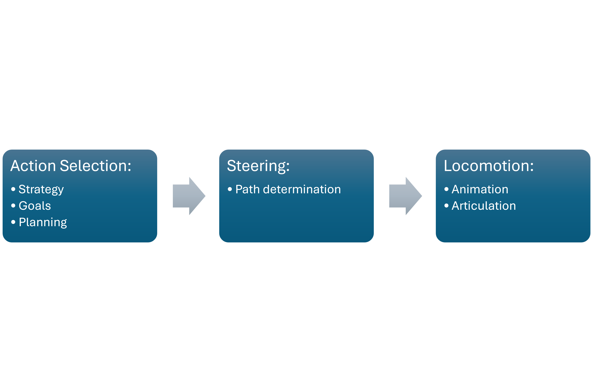
:::

# Mathematical Foundations {.section-divider}

Simple local mathematics and vector calculations for realistic movement.

## Vectors and Kinematics

An autonomous agent is modeled as a point mass driven by three vectors:

- **Position** ($\mathbf{p}$) - where the agent is in the world
- **Velocity** ($\mathbf{v}$) - how fast and in which direction it is moving
- **Acceleration** ($\mathbf{a}$) - the instant change in velocity produced by steering forces

Each simulation step updates the agent with a Euler integration:

::: {.equation}
$$\mathbf{p}_{t+1} = \mathbf{p}_t + \mathbf{v}_t\,\Delta t$$
:::

::: {.small-text .muted}
\(\Delta t\) is the time step.
:::

## Steering Force and Truncation

Steering behaviors produce a **desired velocity**, which is the velocity the agent wants to have at the moment.
The steering force is the difference between the desired velocity and current velocity:

::: {.equation}
$$\mathbf{F}_{steer} = \mathbf{v}_{desired} - \mathbf{v}$$
:::

This force points from the current velocity vector toward the desired velocity, turning and adjusting the agent's speed.

::: {.code-example}
```cpp
steeringForce = truncate (steeringDirection, maxForce)
acceleration = steeringForce / mass
velocity = truncate (velocity + acceleration, maxSpeed)
position = position + velocity
```
:::

::: {.small-text .muted}
Truncation (clamping)
:::


# Individual Behaviors {.section-divider}

Core local steering behaviors for single-agent navigation.

## Seek and Flee

::: {.columns}
::: {.column}
### Seek

Moves the character towards a specific position in the global space, while adjusting its velocity aligned towards the target.

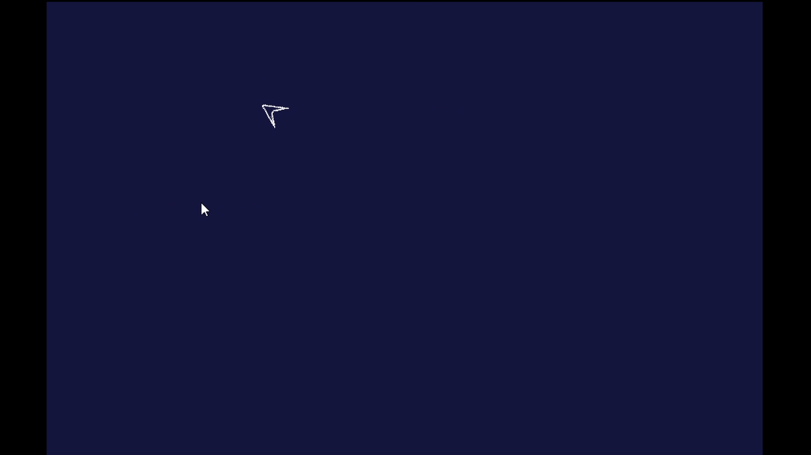
:::
::: {.column}
### Flee

The inverse of Seek and makes the character’s desired velocity point in the opposite direction of the target.


:::
:::

## Arrive

Identical to seek when far from its target. But when the character approaches its target it begins to slow down to stop more smoothly.

::: {.columns}
::: {.column}


:::
::: {.column}


:::
:::

::: {.code-example}
```cpp
targetOffset = target - position
distance = length(targetOffset)
rampedSpeed = maxSpeed * (distance / slowingDistance)
clippedSpeed = min(rampedSpeed, maxSpeed)
desiredVelocity = (clippedSpeed / distance) * targetOffset
steering = desiredVelocity - currentVelocity
```
:::

## Pursuit and Evade

::: {.columns}
::: {.column}
### Pursuit

Similar to Seek but the character chases another moving character, attempts to predict where they are headed and tries to cut them off instead of just following the target.

:::
::: {.column}
### Evasion

The opposite of pursuit, the character tries to escape from other character, while trying to predict the target’s movement and adapt.

:::
:::

::: {.columns}
::: {.column}


:::
::: {.column}


:::
:::

## Wander

A type of random steering, the character moves randomly within a certain area.

::: {.columns}
::: {.column}


:::
::: {.column}


:::
:::

## Obstacle Avoidance

The character manoeuvres through the environment by dodging around obstacles, takes action only when a nearby obstacle is in front of the character.

::: {.columns}
::: {.column}

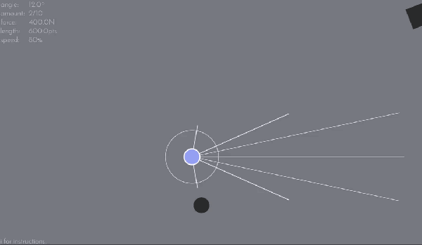

:::
::: {.column}

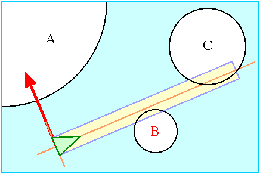

:::
:::

## Follow Path

A character steers along a predetermined path, moves through a series of points along the path. The goal is to 
move the character along the path while staying within the specified radius.


::: {.columns}
::: {.column}


:::
::: {.column}

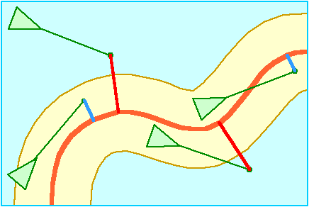

:::
:::

## Flow Field Following

Directs the motion of characters based on their position within an environment. It defines a mapping from a location to a flow vector. It allows for motion specification
without the use of programming.


::: {.columns}
::: {.column}

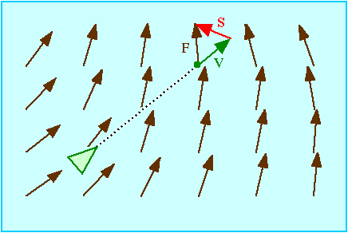

:::
::: {.column}


:::
:::

## Unaligned Collision Avoidance

Tries to keep the characters which are moving in arbitrary directions from running into each other, by avoiding collisions and avoid being stuck. A collision
may occur if the distance between the characters is too small.

::: {.columns}
::: {.column}

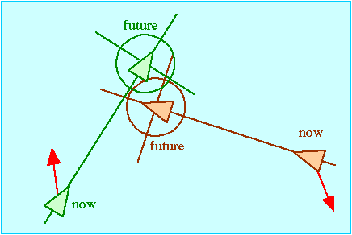

:::
:::

# Group Behaviors {.section-divider}

Coordinated movement across multiple nearby characters.

## Separation, Alignment, Cohesion

::: {.columns}
::: {.column}
### Separation

The character maintains a separation distance from other characters nearby to prevent crowding.
:::
::: {.column}
### Alignment

The character gains the ability to align its direction and speed with other characters nearby to have the same pace.
:::
::: {.column}
### Cohesion

The character gains the ability to approach and form a group with other characters nearby.
:::
:::

::: {.columns}
::: {.column}

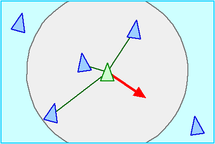

:::
::: {.column}

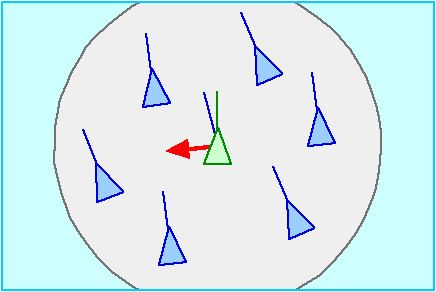

:::
::: {.column}

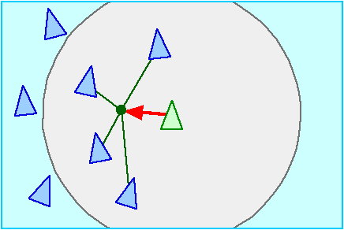

:::
:::

## Flocking (also known as Boids)

Flocking simulates the movement of characters that are grouped together, combining Separation, Cohesion, and Alignment behaviors to replicate birds or fish flocks, for example.

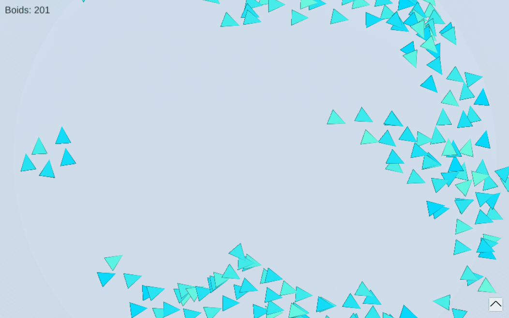

## Leader Following

Makes one or more characters follow another moving character as their leader, staying near them without getting in their way.

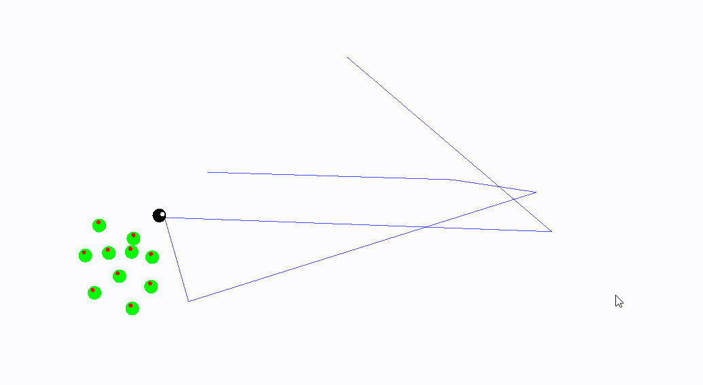

# Combining Behaviors {.section-divider}

A character may switch between behavior modes as circumstances change in the game, such as events.

## Weighted Blending

Some behaviors are commonly blended together and effectively act in parallel. A good example is when an animal NPC is running through the woods escaping a predator: this NPC can use the flee and obstacle avoidance behaviors to navigate effectively.

> Blending is done by calculating the weighted sum of the steering forces produced by each behavior, and then truncating the result to the maximum force allowed.

<br>

::: {.equation}
$$\mathbf{F} = \sum_i w_i\,\mathbf{F}_i$$
:::

# Demonstration {.section-divider}

Interactive steering behaviors in action.

## Interactive Simulation

::: {.center-content}
<canvas id="steering-canvas" width="900" height="450"></canvas>
:::

::: {.small-text .muted}
[Replace the canvas drawing in scripts.js with your simulation.]
:::

# Conclusion {.section-divider}

Why use steering behaviors and where do they appear in games?

## Summary

- **Performance:** Highly CPU efficient by using simple local mathematics and vector calculations — ideal even for mobile games.
- **Realism:** Movement can be very realistic due to velocity and path changes, with many different NPC actions when behaviors are combined.
- **Use Cases:** Used across many genres with large numbers of NPCs — Racing (AI opponents/traffic), Driving (AI traffic), Action, Role-Playing, and Open-World games.

::: {.callout}
As you may have noticed, we have been using these types of behaviors in our projects and classes.
:::

## References

::: {.small-text}
- [1] C. Reynolds, “Steering Behaviors For Autonomous Characters,” Red3d, 1999. https://www.red3d.com/cwr/steer/gdc99/ (accessed Nov. 01, 2026).

- [2] K. Peters, AdvancED ActionScript 3.0 Animation. Friends of Ed/Apress, 2009.

- [3] NCoT Technology, “Steering Behaviours,” NCoT Wiki, Nov. 10, 2026. https://wiki.ncot.uk/Game%20Development/AI%20and%20Pathfinding/Steering%20Behaviours/ (accessed Nov. 10, 2026).

- [4] “Steering Behaviors | Glossary | GDQuest,” Gdquest.com, 2026. https://school.gdquest.com/glossary/steering_behaviors (accessed Nov. 10, 2026).

- [5] J. Perez, “Introduction to Steering Behaviours,” GameDeveloper.com, June 24, 2014. https://www.gamedeveloper.com/design/introduction-to-steering-behaviours

- [6] D. , “Steering Behaviours: Flocking,” Github, Jan. 03, 2014. https://howtorts.github.io/2014/01/03/steering-flocking.html (accessed Nov. 09, 2026).


:::

## Questions? {.center-content}

Thank you for your time!